## Plan de pruebas (TEST PLAN) - Creepy Toys App:

## Introducción y objetivo:
El objetivo de este plan de pruebas es validar la calidad, usabilidad, responsividad y correcto funcionamiento del flujo completo de compra (E2E) en la aplicación.

## Alcance (Scope):
## Dentro del alcance (In Scope):
**UI y layouts**: Verificación de responsividad en 2 columnas (portrait) y en API 3 columnas (landscape) con `GridLayoutManager`.
**Visualización**: Renderizado de tarjetas sin truncamiento de texto y modal de imagen flotante.
**Filtros**: Filtrado por franquicias (*Chucky*, *FNAF*, *Poppy Playtime*, *Stranger Things*).
**Persistencia local**: Operaciones CRUD en el carrito usando `SharedPreferences` (`CartPreferences`).
**Sincronización del UI**: Badge en la ToolBar actualizado en tiempo real y durante el ciclo de vida (`onResume`).
**Checkout y validaciones**: Validaciones de formulario (envío y tarjeta) y ocultamiento dinámico según el método de pago seleccionado.
**Reseteo**: Limpieza completa de datos tras la confirmación del pedido.

## Fuera del alcance (Out of Scope):
- Procesamiento de pagos reales con pasarelas (Stripe, Pay Pal, etc.).
- Autenticación de usuario o login remoto.
- Integración con APIs REST / Backend en la nube.

## Entorno de pruebas:
- **Dispositivos**: Emulador Android Studio AVD Google Pixel 9 / Dispositivo Físico Android.
- **Versión Mínima SDK**: Android 9.0 Pie (API 28).
- **Orientaciones**: Vertical (Portrait) y horizontal (Landscape).

## Estrategia de pruebas:
Ejecutamos una combinación de:
- **Pruebas de funcionalidad**: Validación de comportamiento de la interfaz y persistencia de datos.
- **Pruebas de UI/UX y Responsividad**: Adaptación de cuadrículas y legibilidad de elementos visuales.
- **Pruebas de caso negativo / Validaciones**: Control de errores ante entradas vacías o incompletas en el formulario del Checkout.
- **Pruebas End to End (E2E)**: Simulación del flujo completo de un usuario desde la exploración del catálogo hasta la confirmación de la compra.

# Matriz de Casos de Prueba - Creepy Toys App

En este documento registro la ejecución de los casos de prueba para el flujo de la aplicación en tablet.

* **Dispositivo / Entorno:** Tablet Android (Emulador Pixel Tablet)
* **Sistema Operativo:** Android 9.0 Pie (API 28)
* **Fecha de ejecución:** Noviembre 2026

---

#  Matriz de Casos de Prueba (Test Cases)

**Proyecto:** Creepy Toys App  
**Entorno de ejecución:** Tablet (Emulador / Dispositivo Físico Android — API 28+)

---

# 📋 Matriz de Casos de Prueba (Test Cases)

**Proyecto:** Creepy Toys App  
**Entorno de ejecución:** Tablet (Emulador / Dispositivo Físico Android — API 28+)

---

##  Resumen de Casos de Prueba

| ID Caso | Módulo | Descripción / Escenario | Pasos de Ejecución | Resultado Esperado | Estado | Evidencia |
| :--- | :--- | :--- | :--- | :--- | :---: | :---: |
| **TC-001** | UI | Responsividad Tablet (Portrait) | Abrir la app en posición vertical en la tablet. | El catálogo se muestra distribuido en **2 columnas** aprovechando el ancho de pantalla. | PASSED | [Ver sección](#tc-001--tc-002-responsividad-en-tablet) \| [Abrir imagen](docs/screenshots/tc001_tablet_portrait.jpeg) |
| **TC-002** | UI | Responsividad Tablet (Landscape) | Girar la tablet a posición horizontal. | El catálogo se reajusta a **3 columnas** sin superposición de elementos. | PASSED | [Ver sección](#tc-001--tc-002-responsividad-en-tablet) \| [Abrir imagen](docs/screenshots/tc002_tablet_landscape.jpeg) |
| **TC-003** | UI | Modal de Imagen | Hacer tap sobre la imagen de cualquier juguete. | Se despliega un diálogo flotante a pantalla completa con la imagen del producto. | PASSED | [Ver sección](#tc-003--tc-004-interacción-y-filtros) \| [Abrir imagen](docs/screenshots/tc003_image_modal.jpeg) |
| **TC-004** | Filtros | Filtrado por Franquicia | Seleccionar el Chip "Chucky". | La lista se filtra mostrando únicamente productos de la franquicia seleccionada. | PASSED | [Ver sección](#tc-003--tc-004-interacción-y-filtros) \| [Abrir imagen](docs/screenshots/tc004_filter.jpeg) |
| **TC-005** | Carrito | Agregar producto y Badge | Presionar "Agregar" en un producto. | El botón notifica con un Toast y el Badge de la Toolbar incrementa su valor. | PASSED | [Ver sección](#tc-005-a-tc-007-gestión-de-carrito) \| [Abrir imagen](docs/screenshots/tc005_badge.jpeg) |
| **TC-006** | Carrito | Persistencia local | Agregar artículos, cerrar/destruir la app y reabrir. | El carrito y el Badge mantienen los artículos previamente agregados. | PASSED | [Ver sección](#tc-005-a-tc-007-gestión-de-carrito) \| [Abrir imagen](docs/screenshots/TC006.jpeg) |
| **TC-007** | Carrito | Modificar cantidades | Abrir el BottomSheet/Diálogo del carrito y presionar `+` / `-`. | El total acumulado y las cantidades unitarias se recalculan en tiempo real. | PASSED | [Ver sección](#tc-005-a-tc-007-gestión-de-carrito) \| [Abrir imagen](docs/screenshots/tc007_cart_dialog.jpeg) |
| **TC-008** | Checkout | Validación de Campos Vacíos | Presionar "Confirmar Pedido" con nombre (< 10 chars) o dirección (< 10 chars). | Muestra mensaje de error en el campo correspondiente (`error`) y solicita foco. | PASSED | [Ver sección](#tc-008-a-tc-010-validaciones-de-checkout-y-ux) \| [Abrir imagen](docs/screenshots/TC008.jpeg) |
| **TC-009** | Checkout | Lógica de Método de Pago | Seleccionar la opción "Pago en Efectivo". | El contenedor con los campos de la tarjeta (`container_card_fields`) se oculta (`GONE`). | PASSED | [Ver sección](#tc-008-a-tc-010-validaciones-de-checkout-y-ux) \| [Abrir imagen](docs/screenshots/tc009_cash_payment.jpeg) |
| **TC-010** | Checkout | Validación de Tarjeta | Seleccionar "Tarjeta" e ingresar < 16 dígitos, fecha inválida o CVV < 3 dígitos. | Arroja mensaje de error impidiendo procesar el pago hasta corregirlo. | PASSED | [Ver sección](#tc-008-a-tc-010-validaciones-de-checkout-y-ux) \| [Abrir imagen](docs/screenshots/tc010_validatio_error.jpeg) |
| **TC-011** | E2E | Compra Exitosa con Nombre | Completar datos con Nombre `"Charles Lee Ray"` y confirmar pedido. | Muestra `AlertDialog` con mensaje personalizado *"¡Gracias por tu compra, Charles Lee Ray!..."*, limpia `SharedPreferences` y resetea el carrito a `0`. | PASSED | [Ver sección](#tc-011-flujo-end-to-end-exitoso) \| [Abrir imagen](docs/screenshots/tc011_success_personalized.jpeg) |

---

## 📷 Evidencias de Ejecución (Screenshots)

### TC-001 & TC-002: Responsividad en Tablet
| Modo Portrait (Tablet Vertical) | Modo Landscape (Tablet Horizontal) |
| :---: | :---: |
| 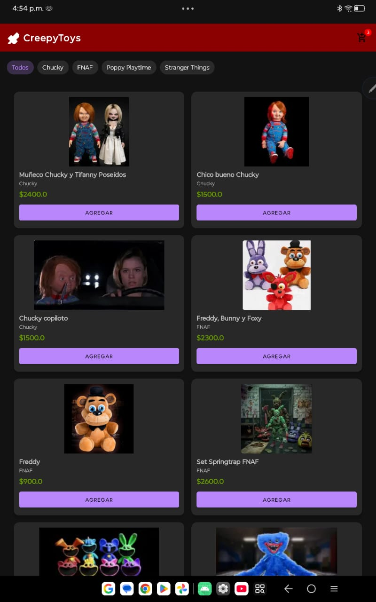 | 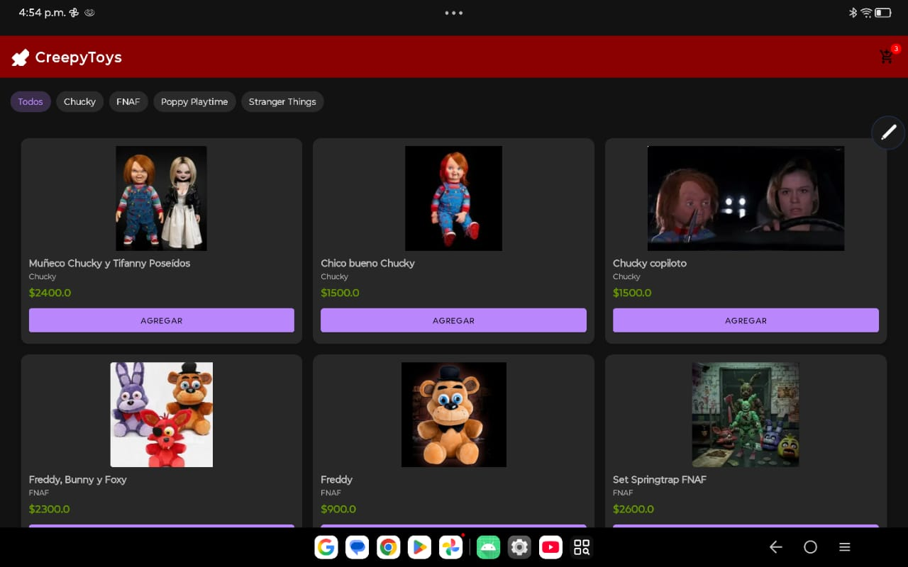 |

### TC-003 & TC-004: Interacción y Filtros
| Modal de Imagen Ampliada | Filtro Dinámico por Franquicia |
| :---: | :---: |
|  | 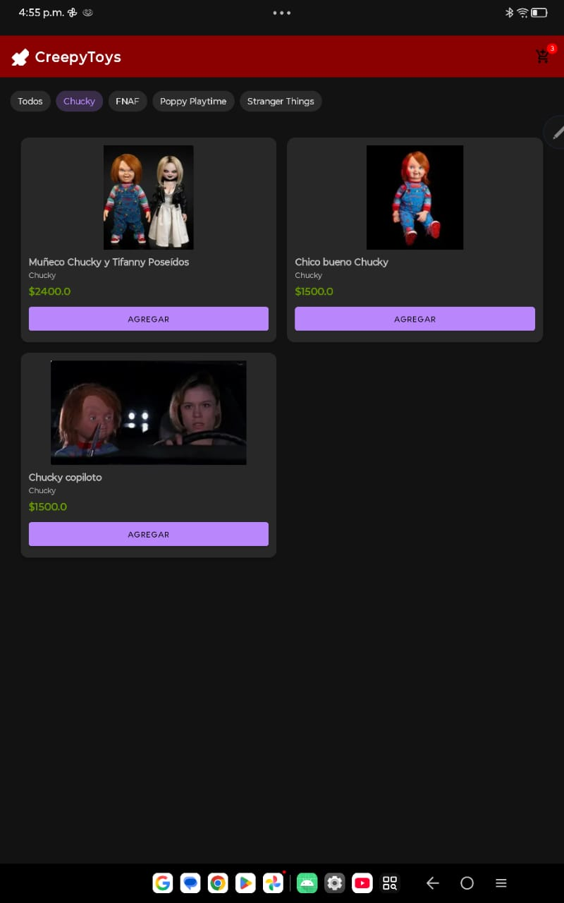 |

### TC-005 a TC-007: Gestión de Carrito
| Badge en Toolbar | Persistencia al Reabrir | Carrito (Diálogo) |
| :---: | :---: | :---: |
| 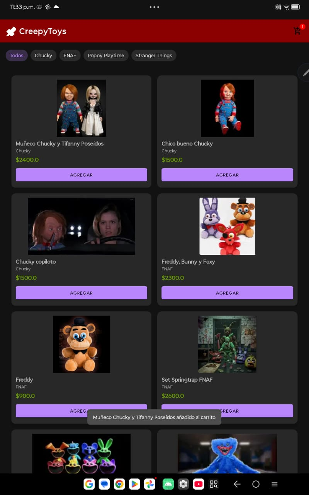 | 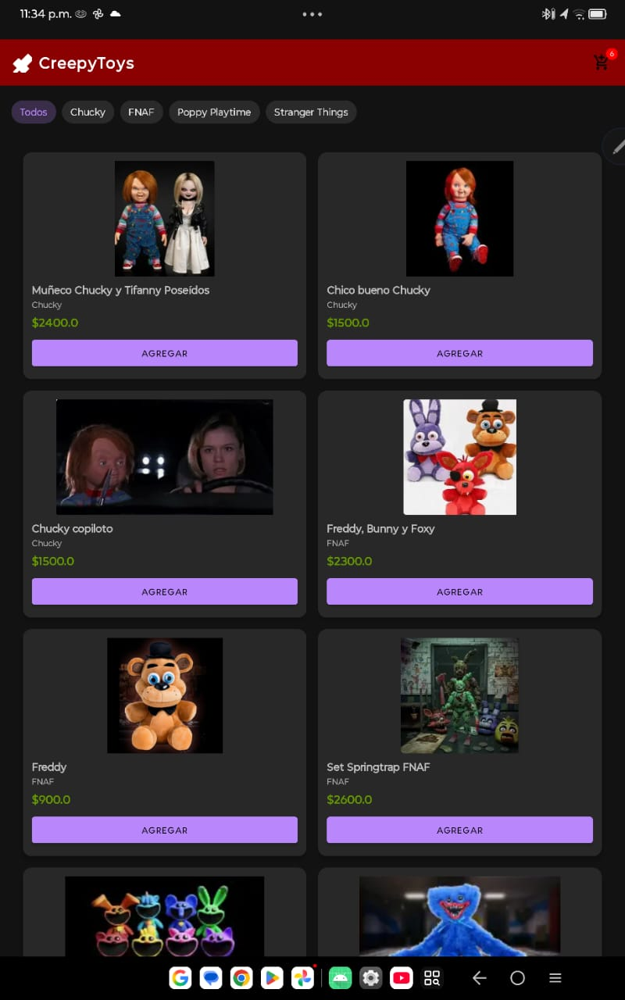 | 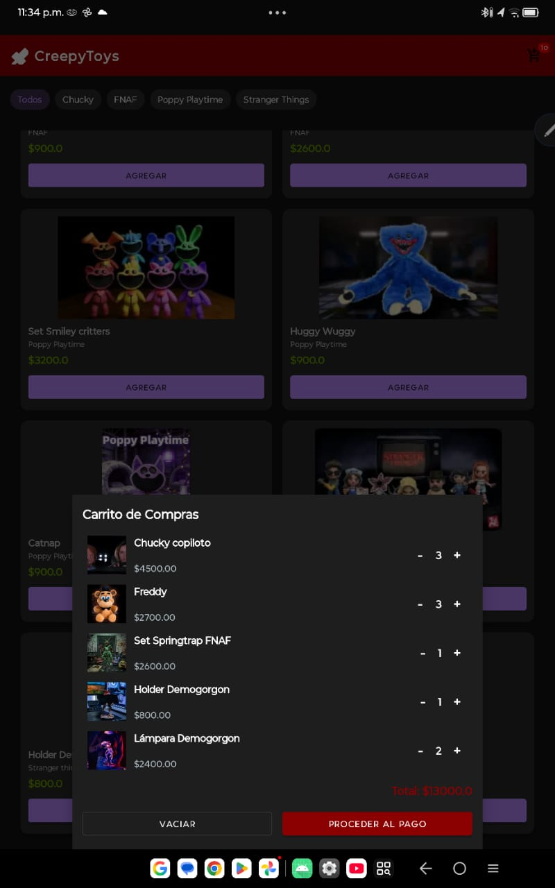 |

### TC-008 a TC-010: Validaciones de Checkout y UX
| Error Campos Vacíos | Ocultamiento (Efectivo) | Error Número Tarjeta |
| :---: | :---: | :---: |
| 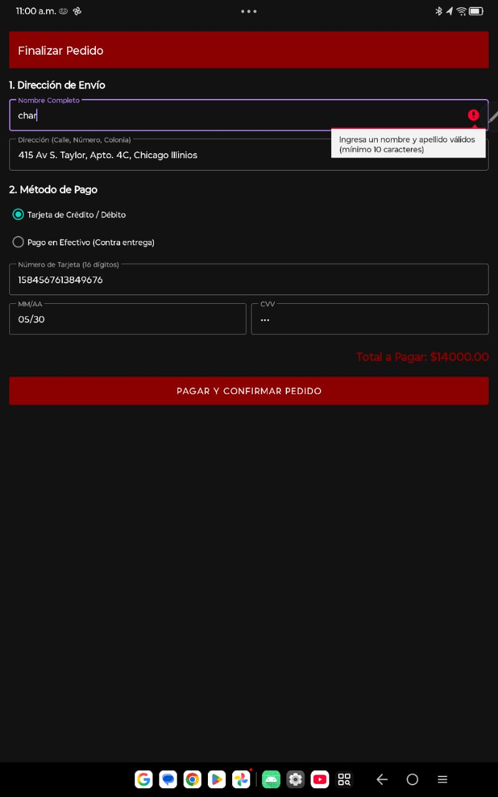 | 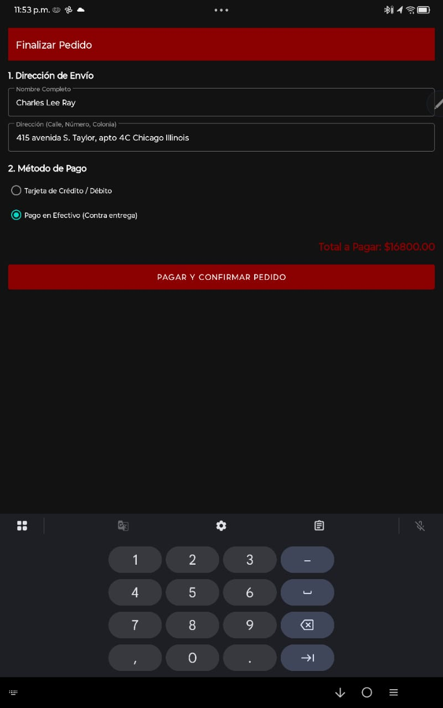 |  |

| Error Fecha Vencimiento | Error Código CVV |
| :---: | :---: |
| 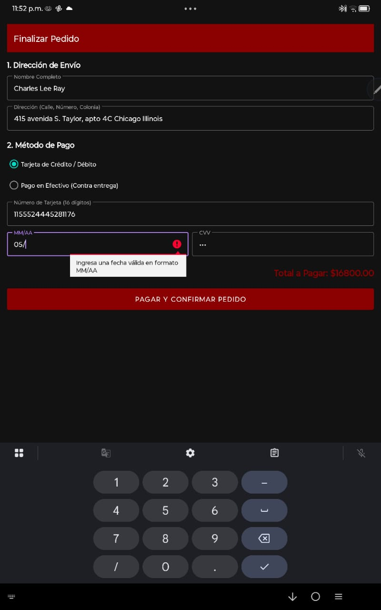 | 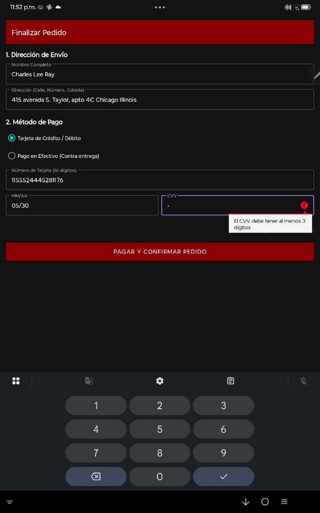 |

### TC-011: Flujo End-to-End Exitoso
| Diálogo Personalizado con Nombre del Usuario y Reseteo |
| :---: |
| 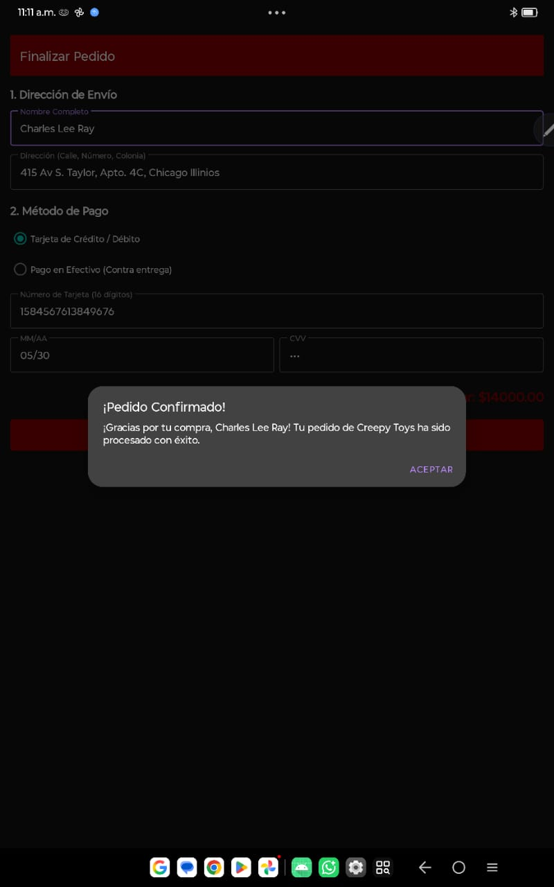 |
